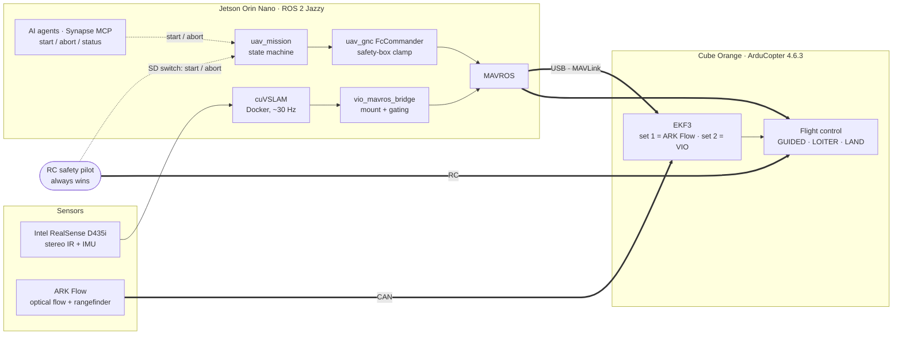
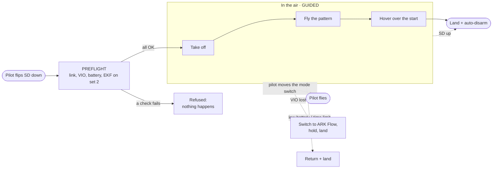

# agenticROS-Drone: GPS-denied autonomous flight with agentic AI

**UAV @ Notre Dame (UAV-ND)** software for the **Raytheon Autonomous Vehicle Competition (AVC) 2026–27**.

We are building a drone that flies, searches and lands **with no GPS**, using a Jetson Orin Nano companion
computer, visual-inertial odometry (VIO) and optical flow, on top of an ArduPilot flight controller. An AI
agent layer (forked from Corebrum Synapse) lets teammates and agents start missions and read status in plain
language, while the flight-critical code stays deterministic, tested and under the safety pilot's control.

> **New here, or pointing an AI agent at this repo? Start with the [project wiki](wiki/README.md).**

## The research question

How well can a small team fly a drone **autonomously indoors with no GPS**, using only onboard sensing, and keep
it safe enough to fly next to people? We're working through it in steps:

1. **Navigation without GPS.** Two position sources the flight controller can switch between in flight:
   **ARK Flow** (downward optical flow + rangefinder) and **VIO** (Intel RealSense D435i + NVIDIA cuVSLAM on the
   Jetson, fed to the flight controller's EKF).
2. **Autonomy you can trust.** A small, unit-tested mission state machine on the Jetson that flies patterns,
   handles failures itself (VIO loss → fall back to optical flow and land; low battery → return) and always
   yields to the RC pilot.
3. **Perception.** A YOLO model that detects coloured dice from a downward camera, so the drone can search an
   area and centre over a target.
4. **Agentic control.** AI agents (Claude, Codex, Gemini, ...) start and abort missions and report status,
   rather than flying the drone directly.

## The competition

The AVC is flown **indoors in a gym**, inside drone nets, **without GPS**. The drone starts in a 5 ft square
taped on the floor in a corner the judges choose, flies its mission (search the area, find and centre over
coloured dice) and must return to land fully inside that square.

## Where we are (2026-11)

| Milestone | Status |
|---|---|
| Manual flights without GPS (optical flow) | done 2026-11-13 |
| VIO fused by the flight controller; LOITER on VIO outdoors | done 2026-11-17 / 18, held ~0.2 m |
| **Autonomous 3 m square on VIO**, started by an RC switch | **flown: corners within 7 cm, landed 3 cm from takeoff** |
| Fast autonomous 10 m square at 3 m (~3.8 m/s) | simulator and props-off bench test passed, first flight (1 m/s) next |
| Competition mission (search, centre on die, return) | written and unit-tested, not flown yet |
| Dice detection | trained YOLO models, integration in progress |

Details, numbers and logs: [wiki flight log](wiki/08-flight-log.md) and [changelog](wiki/11-changelog.md).

## System at a glance



An autonomous flight, from the pilot's switch to touchdown:



Hardware: Tarot 650 quad (6S), Cube Orange (ArduCopter 4.6.3), Jetson Orin Nano, ARK Flow, Intel RealSense
D435i, Arducam AR0234 (dice), FrSky X8R, RFD900x.

## Codebase overview

| Path | What |
|---|---|
| [`ros2_ws/src/uav_vio/`](ros2_ws/src/uav_vio/) | VIO → flight controller bridge (mount transform, jump/variance gating) and a read-only status monitor |
| [`ros2_ws/src/uav_gnc/`](ros2_ws/src/uav_gnc/) | `FcCommander`: the only code that commands the flight controller, clamped to a safety box |
| [`ros2_ws/src/uav_mission/`](ros2_ws/src/uav_mission/) | Mission state machine, mission files (`config/`), boot services and health checks (`systemd/`), simulator kit (`sitl/`) |
| [`packages/ros-camera/src/vio/`](packages/ros-camera/src/vio/) | VIO bring-up tools, flight-controller settings files and a read-only settings checker |
| [`packages/object-detection/`](packages/object-detection/) | Dice detection (YOLO, 4 colours): training, live detection |
| [`packages/synapse-drone-claude-code/`](packages/synapse-drone-claude-code/) | Drone tools for AI agents over MCP |
| [`mvp/`](mvp/) | Mission and architecture diagrams |
| [`wiki/`](wiki/README.md) | Project wiki: how everything works, procedures, results, rules |
| everything else (`packages/core`, `packages/synapse-*`, `ros2_ws/src/synapse_*`, `docs/`, ...) | Upstream Corebrum Synapse (see [below](#built-on-corebrum-synapse)) |

Quick start on the Orin (unit tests; the full stack starts at boot as systemd services):
```bash
cd ros2_ws && source /opt/ros/jazzy/setup.bash
colcon build --symlink-install --packages-select uav_gnc uav_mission uav_vio && source install/setup.bash
for p in uav_gnc uav_mission uav_vio; do (cd src/$p && python3 -m pytest -q test); done
```
Simulator (ArduCopter SITL, no drone needed): [`ros2_ws/src/uav_mission/sitl/README.md`](ros2_ws/src/uav_mission/sitl/README.md).

## Using the wiki

The [wiki](wiki/README.md) is plain Markdown in this repo, written for **both people and AI coding agents**.

- **People:** start at [wiki/README.md](wiki/README.md) for the current status and the page index. Going to the
  field? Print the [flight-day checklist](wiki/flight-day-checklist.md).
- **AI agents:** tell your agent *"read `wiki/README.md` first"* before it touches the drone code. The home page
  has the **rules for agents** (e.g. never write flight-controller parameters, all commands go through
  `FcCommander`, test in the simulator before the drone, ask before pushing or merging). The root `CLAUDE.md`
  and `AGENTS.md` point agents there too.
- **Keeping it current:** every PR that changes behaviour, procedures or results updates the relevant wiki page
  and adds a line to the [changelog](wiki/11-changelog.md). See [Development process](wiki/10-development-process.md#updating-the-wiki).

| If you want to... | Read |
|---|---|
| understand the system | [01 System overview](wiki/01-system-overview.md) |
| find code | [02 Repository map](wiki/02-repo-map.md) |
| work on autonomy | [04 Missions](wiki/04-missions.md), [06 Simulation](wiki/06-simulation.md) |
| prepare a flight | [07 Flight operations](wiki/07-flight-operations.md) |
| contribute | [10 Development process](wiki/10-development-process.md) |
| find something to work on | [12 Open items](wiki/12-open-items.md) |

## Safety

The RC safety pilot can take over at any moment with the flight-mode switch, and an RC switch aborts any
mission. Code on the Jetson never changes flight-controller parameters; humans set those in Mission Planner.
Every mission change goes through unit tests, the simulator and a props-off bench test before it flies.

## Built on Corebrum Synapse

This repository is a fork of **[Corebrum Synapse](https://github.com/PlaiPin/synapse)** (formerly
**AgenticROS**) by **Chris Matthieu** and contributors (PlaiPin), an open, agent-agnostic layer that connects
AI agents (OpenClaw, Claude, Codex, Gemini, Hermes, ...) to ROS 2 robots. We forked it at release
**0.7.42** (November 2026) and adapted its tool layer from ground robots to our drone. Thank you to the
Synapse team for building and open-sourcing it: our agent integration stands on their transport, MCP server
and tool architecture.

The original project README, with Synapse's own install and usage instructions, is kept in
**[SYNAPSE_README.md](SYNAPSE_README.md)**, and its docs remain in [`docs/`](docs/).

## Team

UAV @ Notre Dame (UAV-ND), University of Notre Dame. Software team: GPS-denied navigation, autonomy and computer
vision, working with the vehicles and electrical teams. Contact: uavnd@nd.edu.

## License

Apache License 2.0, as upstream ([LICENSE](LICENSE)). Original work © the Corebrum Synapse / AgenticROS authors;
UAV-ND additions © UAV @ Notre Dame.
