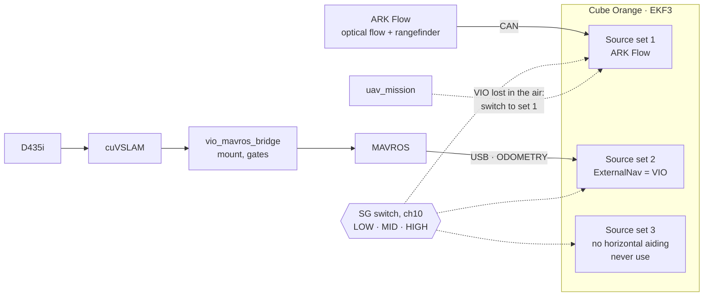
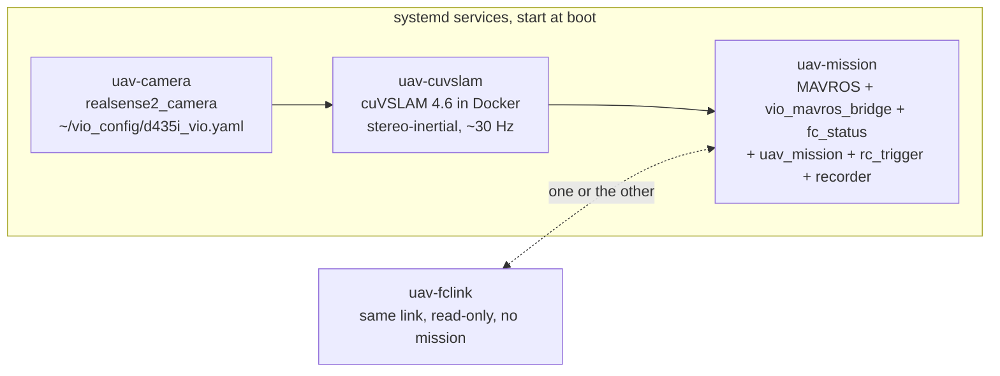

# 01 System overview

[← wiki home](README.md)

## The competition

Raytheon AVC 2026–27, flown **indoors in a gym** inside drone nets, **no GPS**. The drone starts in a 5 ft
(1.52 m) blue-tape square at a judge-chosen corner and must come back fully inside it. The MVP mission:
take off to 3 m → transit → grid sweep → centre over a coloured die → land / return
(diagrams: `mvp/uav_simplified_mission_state_machine_v3.svg`, `mvp/uav_simplified_software_architecture_v3.svg`).

## Hardware

| Part | What |
|---|---|
| Airframe | Tarot 650 quad, 6S LiPo (Zeee 6000 mAh), X4110S KV400 motors. Overpowered: hover throttle ~16%, ~12.5 A |
| Flight controller | **Cube Orange, ArduCopter 4.6.3**, USB to the Orin (MAVLink via MAVROS) |
| Companion computer | **Jetson Orin Nano**, Ubuntu 24.04, ROS 2 Jazzy, JetPack 7 (R39), 25 W mode |
| Primary GPS-denied sensor | **ARK Flow** (optical flow + rangefinder) on the Cube's CAN1 (DroneCAN), straight into EKF3 |
| VIO camera | **Intel RealSense D435i**, USB 3, 30 fps, IR emitter off; mounted 134 mm forward, 110 mm below the Cube centre, ~0.6° up |
| Dice camera | Arducam 2.3 MP AR0234 global shutter USB 3 (dice detection track) |
| Radio | FrSky X8R receiver, RFD900x telemetry |

## Navigation: two switchable sources

The Cube's EKF3 has **source sets**. We use two, never fused at the same time:

- **Set 1, ARK Flow**: works with no Orin in the loop. Fallback for everything.
- **Set 2, VIO**: what the autonomous missions fly on (they refuse to start otherwise). Holds position to a few cm.
- The mission switches to set 1 itself if VIO is lost in the air (then holds and lands).
- SG **HIGH = set 3 = no aiding. Never use it.**

## Who commands the drone

| Actor | May do |
|---|---|
| RC pilot | everything; always wins (flight-mode switch takes over, SF/ch5 arms and disarms) |
| `uav_mission` (Orin) via `uav_gnc.FcCommander` | GUIDED/LAND/RTL mode, arm, takeoff, position/velocity setpoints, GUIDED speed limit, EKF source switch, EKF origin. **Never parameters.** |
| AI agent (Synapse MCP) | start/abort the mission, read status |
| Humans in Mission Planner | Cube parameters, calibration |

## Software on the Orin (all start at boot)

The pilot starts a mission by flipping **SD (ch6) down**. Details: [04 Missions](04-missions.md),
[05 Boot services](05-boot-services-and-checks.md).

## Coordinate frames

- Without GPS the EKF's "east/north" are arbitrary (the VIO start pose). The mission sends an EKF origin
  (`SET_GPS_GLOBAL_ORIGIN`) in PREFLIGHT, because ArduCopter refuses to arm without one ("waiting for home").
- Missions are defined in the **takeoff frame**: metres forward / left of where the drone armed, along the
  heading it had then (the direction the camera faces). Negative `square_side` mirrors to forward-right.
