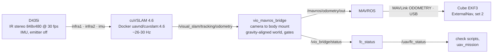
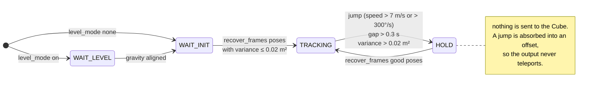

# 03 VIO pipeline

[← wiki home](README.md)



## History

- OpenVINS was tried first (Oct–Nov 3) and **diverged on every D435i bag**; abandoned.
- cuVSLAM stereo-inertial worked live from 2026-11-04: ~30 Hz, 17–21 ms latency, 3–5 cm loop error over 16 m handheld.
- 2026-11-17 bench carry on set 2: EKF vs VIO median 1 mm (p95 1.7 cm).
- 2026-11-18 outdoor flight: LOITER on VIO held ~0.2 m; EKF followed VIO within ~4 cm.
- First autonomous square: VIO 29.4 Hz to the Cube, no gaps, pose variance ≤ 0.0018 m².

## The bridge (`ros2_ws/src/uav_vio/config/vio_bridge.yaml`)

| Setting | Value | Meaning |
|---|---|---|
| `cam_x / cam_y / cam_z` | 0.134 / 0 / −0.110 m | camera position from the Cube centre (forward, left, up) |
| `cam_pitch_down_deg` | −0.6 | lens tilted 0.6° **up** (positive = down) |
| `max_rate_hz` | 30 | output rate cap |
| `max_speed` | 7.0 m/s | a jump implying more than this is rejected (raised from 4 for the fast square) |
| `max_ang_rate_deg` | 300 °/s | same for rotation |
| `max_pos_var` | 0.02 m² | cuVSLAM pose variance above this → the bridge HOLDs (stops sending) |
| `max_gap_s` | 0.3 s | input gap → HOLD until it recovers |
| `max_age_s` | 0.25 s | input older than this is dropped |

Bridge states (on `/vio_bridge/status`), from `uav_vio/vio_bridge_core.py`:



Before any of that, poses older than `max_age_s` or out of order are dropped. Only `TRACKING` sends to the Cube. `fc_status` publishes
`/uav/fc_status` at 1 Hz: link, armed, mode, EKF source set, bridge state, warnings.

Known behaviour: at takeoff/landing (props wash, close ground) cuVSLAM variance can briefly reach 0.02–0.05
and the bridge holds for < 1 s. The missions tolerate VIO pauses up to `vio_timeout_s` (1.5 s for the
3 m square, 1.0 s for the fast one) before failing over to ARK Flow.

## Checks

```bash
cd ~/Documents/uav-nd/agenticROS-Drone/ros2_ws/src/uav_mission/systemd
bash check_camera.sh     # camera fps from frame timestamps
bash check_cuvslam.sh    # cuVSLAM >= 20 Hz (normal 26-30)
bash check_fclink.sh     # MAVROS, Cube streams, RC, bridge TRACKING, VIO to Cube >= 20 Hz
bash check_all.sh        # all of the above + check_mission.sh
```

## Rules learned the hard way

- **Don't move the drone after cuVSLAM starts** and before takeoff on the marked spot; the VIO origin is where it started.
- The IR emitter must be off, and that only takes effect from the config file (the launch argument is ignored).
- Accel at 250 Hz (at 63 Hz most IMU samples repeat).
- Clocks: the Orin has no RTC battery; outdoors without network the clock reads 1969. Recordings are numbered
  (`run####`, `boot####`) instead of dated for that reason.
- If the Cube's VIO parameters silently revert, the EKF ignores VIO even though the bridge is fine.
  Always run the parameter check ([09](09-cube-parameters.md)).

Older detail: `packages/ros-camera/src/vio/REPORT_2026-11-06_vio_to_flight_controller.md`, `ros2_ws/src/uav_vio/README.md`.
