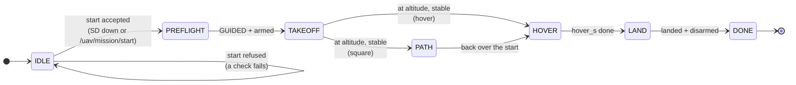
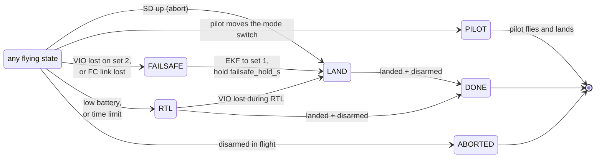
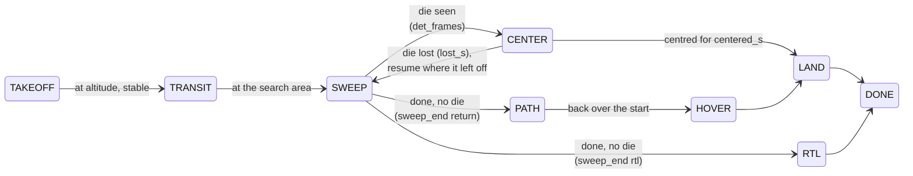
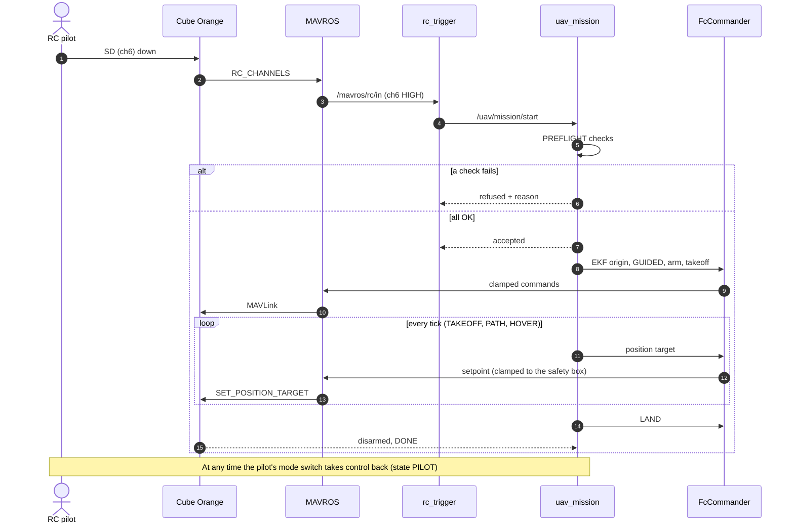

# 04 Missions

[← wiki home](README.md)

Code: `ros2_ws/src/uav_mission/` (state machine) and `ros2_ws/src/uav_gnc/` (the only code that commands the Cube).

## How a mission runs on the drone

1. At boot `uav-mission` starts MAVROS, the VIO bridge, `fc_status`, `mission_node`, `rc_trigger` and a recorder.
   The mission sits in **IDLE**. Which mission file it uses: `~/.uav_mission` (see below), default `square_3m_vio`.
2. The pilot flips **SD (ch6) down** (LOW → HIGH). `rc_trigger` calls `/uav/mission/start`.
3. **PREFLIGHT** checks everything (link, EKF position, battery, VIO healthy and EKF on set 2, not armed).
   If anything fails, the start is **refused** and nothing happens (reason in `/uav/mission/state` and
   `check_mission.sh`); flip SD up, fix it, flip down again. It also sends the EKF origin if the Cube has none.
4. GUIDED → arm → **TAKEOFF** to `takeoff_alt`, wait until stable (`stable_s`).
5. **PATH** (fly the pattern) → **HOVER** over the start (`hover_s`) → **LAND** (the Cube lands and disarms) → **DONE**.

### State machine (`mission_core.py`)

**Square and hover missions** (what flies today):



**Safety rules**, checked every tick in every flying state (TAKEOFF through CENTER):



Also: PREFLIGHT → ABORTED if it can't enter GUIDED / arm in time (or on abort), and TAKEOFF → LAND on takeoff timeout.

**Competition sweep** (`profile: sweep`, written and unit-tested, not flown):



In table form, any time in the air:

| Event | What happens |
|---|---|
| SD (ch6) back up | **abort**: LAND where it is |
| Pilot moves the flight-mode switch | **PILOT**: the mission stops commanding immediately |
| VIO lost > `vio_timeout_s` while on set 2 | **FAILSAFE**: switch EKF to set 1 (ARK Flow), hold `failsafe_hold_s`, land |
| FC link lost | hold, land |
| Battery < `rtl_battery` or flight time > `time_limit_s` | **RTL** (RTL_ALT is 3 m) |

What happens when the pilot flips SD:



ROS interface:

| Name | Type | |
|---|---|---|
| `/uav/mission/start`, `/uav/mission/abort` | `std_srvs/Trigger` | start / abort (what ch6 and an AI agent call) |
| `/uav/mission/state` | `std_msgs/String` JSON, ~1 Hz+ | state, reason, mode, armed, alt, source_set, vio_ok, battery, `preflight_problems`, `path_point`, `fc_errors` |
| `/uav/rc_trigger/status` | String | ch6 trigger status (`ready` when ch6 is LOW and the mission is IDLE) |
| `/uav/ekf_source_cmd` | UInt8 | EKF source switches the mission commanded (the Cube doesn't announce them) |

Watch live: `ros2 topic echo /uav/mission/state --field data`.

## Mission files

| File | Flies | Status |
|---|---|---|
| `config/square_3m_vio.yaml` | 1.5 m high, **3 m square** (forward, left, back, right), 0.3 m/s, carrot mode. Box 5 m radius / 2.5 m / 0.5 m/s. Battery ≥ 50% | **default; flown successfully** |
| `config/square_10m_fast_vio.yaml` | 3 m high, **10 m square**, corner by corner at the **Cube's default speed** (~3.8 m/s peak). Box 16 m radius / 4 m. Battery ≥ 60%, VIO timeout 1.0 s | simulator-tested; real flights step `path_speed` 1.0 → 2.0 → 0.0 |
| `config/flight_test_vio.yaml` | older hover / square / sweep-and-return test profiles | superseded |
| `config/mission.yaml` | defaults for every parameter, incl. the competition sweep | — |

**Choose the mission** (on the Orin, drone disarmed, props off):
```bash
cd ~/Documents/uav-nd/agenticROS-Drone/ros2_ws/src/uav_mission/systemd
bash select_mission.sh                       # list missions, show the current one
bash select_mission.sh square_10m_fast_vio   # choose (stored in ~/.uav_mission, survives reboots)
sudo systemctl restart uav-mission
bash check_mission.sh                        # shows the parameters file; want MISSION READY
```
Editing a value in a mission file takes effect after `sudo systemctl restart uav-mission`.
YAML gotcha: floats must be written as floats (`0.0`, not `0`) or ROS rejects the parameter.

## Profiles and path modes (`mission_core.py`)

- `profile`: `hover` | `square` | `sweep` (the competition mission: transit, lawnmower sweep, centre on the die, land or return).
- `path_mode: carrot` (default): a position target slides along the path at `path_speed`. Smooth, slow
  (position-only targets top out ~1–2 m/s).
- `path_mode: waypoints`: the target is the next corner; ArduPilot plans each leg's speed-up and braking
  (WPNAV_ACCEL 2.5 m/s², jerk-limited) and stops on the corner (next corner within `wp_tol`).
  `path_speed > 0` sends a temporary GUIDED speed limit (`MAV_CMD_DO_CHANGE_SPEED`, after the first hold
  target, because entering position control resets it); `path_speed: 0.0` sends none = the Cube's default
  (WPNAV_SPEED 10 m/s). On 10 m sides acceleration limits the peak to ~3.8 m/s; ~18–20 m sides would be
  needed for 5 m/s. **Decision 2026-11-22: keep 10 m, default speed, no parameter changes.**
- A position + velocity feed-forward version was tried and dropped: the Cube lags ~1 s and it overshot corners by 4.5 m at 5 m/s.

## Safety box (`uav_gnc/limits.py`, set per mission file)

`max_alt`, `min_alt`, `max_radius` (around the takeoff point), `max_speed` (velocity setpoints and the
GUIDED speed limit), `max_vz`. `FcCommander` clamps **every** command to it; out-of-box targets are pulled back in.

## Changing mission code: required steps

1. Unit tests: `cd ros2_ws && source /opt/ros/jazzy/setup.bash && source install/setup.bash`, then in each of
   `src/uav_gnc`, `src/uav_mission`, `src/uav_vio`: `python3 -m pytest -q test`. All must pass.
   Add a test for the new behaviour (`test/test_mission_core.py` has a `FakeCopter` physics stub).
2. `colcon build --symlink-install --packages-select uav_gnc uav_mission uav_vio`.
3. SITL run ([06](06-simulation.md)): full mission to DONE, plus abort (ch6) and takeover if you touched those paths.
4. Props-off bench test on the drone (checklist F1), then flight.
