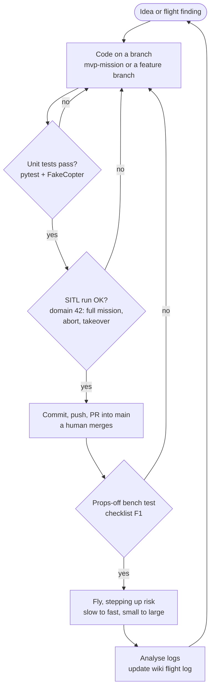

# 10 Development process

[← wiki home](README.md)

## The loop



Every real-flight change has gone through this order; the 3 m square flew right the first time because of it.

## Branches and PRs

- **`mvp-mission`** is the drone software branch. Features are committed there (or on a short branch off it)
  and PR'd into **`main`** (merge commits). Teammates' tracks have their own branches (`dice-tracking-sim`, `drone-tools`).
- Push / open a PR / merge **only when a human asks**. Before merging: `gh pr view <n> --json number,title,headRefName`
  and confirm it's the PR you mean. Other teams open PRs here; we once merged the wrong number (#6).
- PR description: what, how, testing (unit + SITL numbers), what's **not** tested yet.
- Commit messages: imperative summary line naming the feature; body with the why and the test results.

## Tests

```bash
cd ~/Documents/uav-nd/agenticROS-Drone/ros2_ws
source /opt/ros/jazzy/setup.bash && source install/setup.bash     # uav_mission tests import uav_gnc
for p in uav_gnc uav_mission uav_vio; do (cd src/$p && python3 -m pytest -q test); done
colcon build --symlink-install --packages-select uav_gnc uav_mission uav_vio
```
79 tests as of 2026-11-22. The mission logic (`mission_core.py`) and the bridge logic (`vio_bridge_core.py`) are
pure Python so they can be tested without ROS; keep it that way (ROS wrappers stay thin).

Mission files are tested too (`test_mission_core.py` loads each YAML, checks types, limits and that it flies
in `FakeCopter`). New mission file → add a test.

## Code rules

- Only `uav_gnc.FcCommander` talks to the Cube, and everything goes through its `Limits` clamp.
- No Cube parameter writes from code. New MAVLink commands extend the Jetson's command scope: say so in the PR.
- The pilot override (mode switch → PILOT) and ch6 abort must keep working; SITL-test them if you touch states.
- Under ArduPilot GUIDED, re-send streamed setpoints every tick; one-shot commands go through `CommandGate` (retried).
- Subscribe to MAVROS topics with best-effort QoS (`qos_profile_sensor_data`); some publish best-effort only.
- Mission geometry in the takeoff frame (forward/left), never raw ENU.
- Config in YAML, floats written as floats.

## Working on the Orin

- People work over SSH (VS Code Remote-SSH). No GUIs over SSH.
- `sudo` and service changes are done by the human; agents print the exact command.
- The boot service runs from the workspace with `--symlink-install`, so Python edits are live after
  `sudo systemctl restart uav-mission` (new files or entry points need `colcon build` first).
- Never restart services or run SITL while the drone is armed; SITL always on `ROS_DOMAIN_ID=42`.

## Updating the wiki

Update the wiki **in the same PR** as the change it describes:
- behaviour / parameters / procedures → the topic page (and `flight-day-checklist.md` if crews need it);
- a flight or test → a row in [08 Flight log](08-flight-log.md) (and [06](06-simulation.md) for SITL);
- always → one dated line in [11 Changelog](11-changelog.md), and the status table in [README](README.md) if a milestone moved;
- open questions → [12 Open items](12-open-items.md).

Keep pages short and factual, with dates (YYYY-MM-DD) and numbers. Link to code paths instead of copying code.
The flight-day checklist's master copy is `wiki/flight-day-checklist.md`; print from it.
