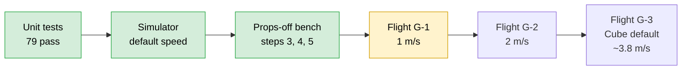

# 13 Testing the fast mission

[← wiki home](README.md)

The test plan and results for the **fast 10 m square at 3 m** (`config/square_10m_fast_vio.yaml`, see
[04 Missions](04-missions.md)). Each stage must pass before the next. Field procedure: checklist
[Part G](flight-day-checklist.md#part-g-fast-autonomous-10-m-square-at-3-m-on-vio-after-part-f-has-worked).

## Status (2026-11-23)

| Stage | Result |
|---|---|
| Unit tests | **pass** (79): corner by corner at 1 m/s, 2 m/s and Cube default; no speed command when `path_speed` is 0.0 |
| Simulator | **pass** (2026-11-22): Cube default speed, peak 3.78 m/s, corners ≤ 7 cm, landed 1 cm from start ([06](06-simulation.md)) |
| Bench step 3: takeoff timeout | **pass** (2026-11-23 13:58): armed in GUIDED, takeoff accepted, 30 s on the ground → LAND → disarmed by itself 4 s later |
| Bench step 4: SD abort | **pass** twice (13:44, 13:51): SD up during takeoff → LAND → disarmed by itself in 4–5 s |
| Bench step 5: pilot takeover | **pass** (14:02): mode switch LOITER → ALT_HOLD; mission went to `PILOT` 0.1 s later and sent nothing more. The drone then stayed armed ~60 s because the throttle was raised (see below); LAND mode disarmed it |
| Flight G-1 (1 m/s) | next |
| Flight G-2 (2 m/s) | after G-1's logs are checked |
| Flight G-3 (Cube default, ~3.8 m/s) | after G-2's logs are checked |

Data: boot 17, `~/flight_logs/run0008_*_mission` (recording open until the next restart/poweroff).

## Props-off bench test (repeat after any change to the mission code or the mission file)

Setup for every step: props **off**, `check_mission.sh` → `MISSION READY`, flight-mode switch **LOITER**,
SG **MID**, ch5 **LOW**, throttle **fully down**, SD **up**. Jetson operator watches
`ros2 topic echo /uav/mission/state --field data`.

| Step | Do | Pass when |
|---|---|---|
| 3 Timeout | SD down, leave it | GUIDED, armed, `TAKEOFF`; ~30 s later `takeoff timeout` → `LAND` → disarmed by itself → `DONE` |
| 4 Abort | SD down; after ~10 s SD up | `LAND` → disarmed by itself → `DONE` |
| 5 Takeover | SD down; after ~5 s move the mode switch LOITER → ALT_HOLD; **keep the throttle fully down** | `PILOT` within ~1 s, mode stays ALT_HOLD, no more `takeoff ... sent` in the log. Then disarm (below) |

**Disarming after step 5 (props off).** The mission has handed over, so it's a normal manual disarm:
- **Throttle fully down and wait**: the Cube sees it's on the ground and disarms after up to 10 s; or
- **mode switch to LAND**: disarms within a second on the ground (this is what worked on 2026-11-23); or
- **ch5 up, then down**: the Orin armed it while ch5 was LOW, so the switch must go HIGH first and then LOW.

Don't raise the throttle after the takeover on the bench: in ALT_HOLD a raised throttle asks for a climb, so
the Cube never thinks it has landed and stays armed, with the motors running up ("Potential Thrust Loss" is
normal with no props). In the air it's the opposite: the throttle is **centred** before switching.

Normal on the bench, not a problem:
- `takeoff 3.0 m: rejected (result=4)` every ~1.5 s: still on the ground after 5 s, so the mission re-sends
  takeoff and the Cube refuses because a takeoff is already in progress. In flight it lifts off well within 5 s.
- `Arm: LAND mode not armable` when ch5 is flicked after it has already disarmed in LAND.
- `check_mission.sh` after a run shows `DONE ... a new SD flip starts it again`: ready for the next step.

## Flights G-1 to G-3

Per flight: edit `path_speed` (1.0, then 2.0, then 0.0), `sudo systemctl restart uav-mission` (disarmed),
`check_mission.sh` shows the new value and READY. Clear area ~16 × 16 m, fresh pack (≥ 60%).

| | G-1 | G-2 | G-3 |
|---|---|---|---|
| `path_speed` | 1.0 | 2.0 | 0.0 (Cube default) |
| Expected top speed | 1 m/s | 2 m/s | ~3.8 m/s |
| Square takes about | 45 s | 25 s | 19 s |

**Go on to the next only if** the last flight: reached `DONE`; passed each marked corner within ~0.5 m; landed
within ~0.5 m of the start; no `FAILSAFE`; and its logs show no VIO dropout over 0.5 s in the air and the EKF
following VIO (send `run####_*_mission` + the Cube `.BIN` for analysis first).

**Take over (mode switch → ALT_HOLD, throttle centred)** if it goes > ~1.5 m past a corner, leaves the marked
area, climbs above ~4 m, wobbles in the turns, or anyone is unsure.

## Watch item: cuVSLAM rate

On 2026-11-23 cuVSLAM ran at **22 Hz** (normal 26–30) with skipped frames, giving 0.3–0.5 s VIO pauses
(10 on the bench in ~30 min; camera itself 30 fps, no drops). The fast mission treats > 1.0 s without VIO as
lost (falls back to ARK Flow and lands). Before each flight: `check_cuvslam.sh` ≥ 26 Hz preferred; if it's
low, check the Orin's load with `tegrastats`. See [12 Open items](12-open-items.md).
